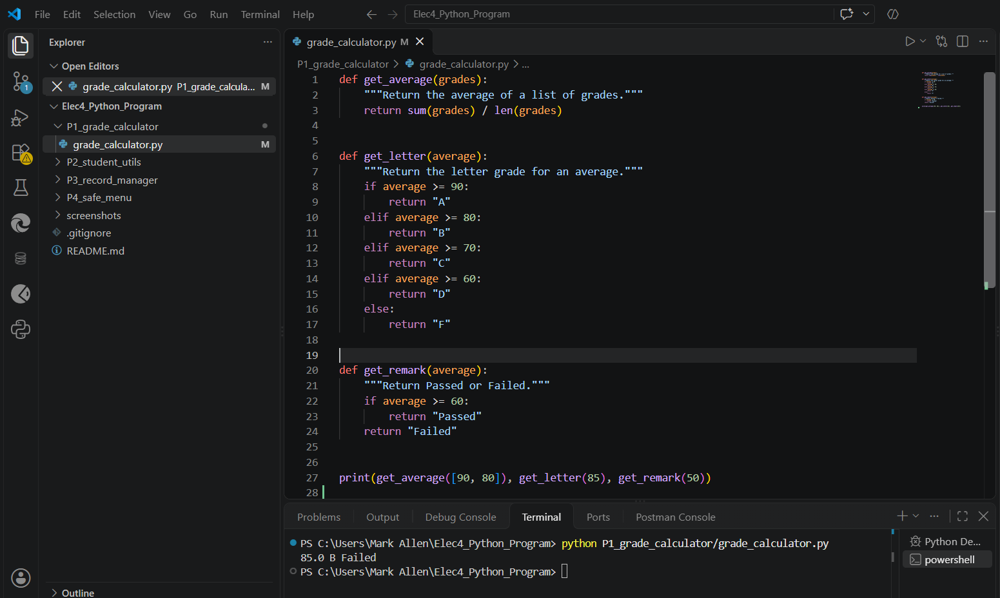
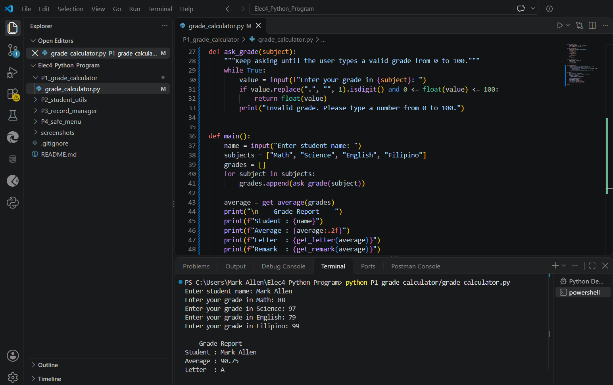
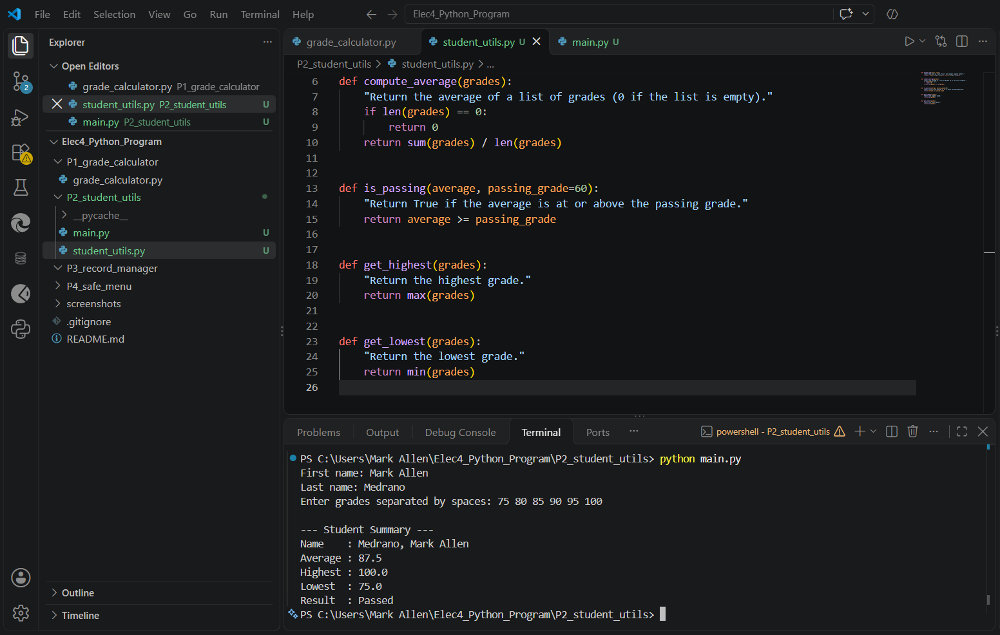
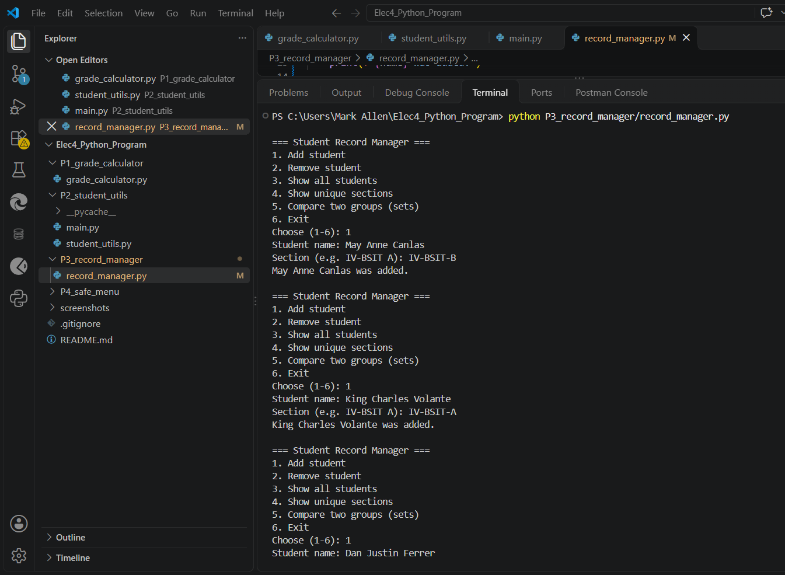
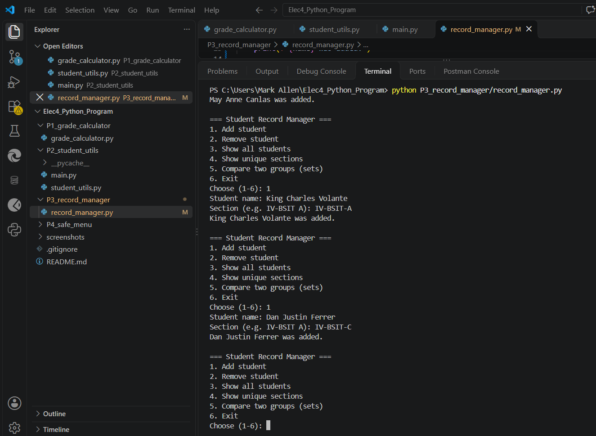
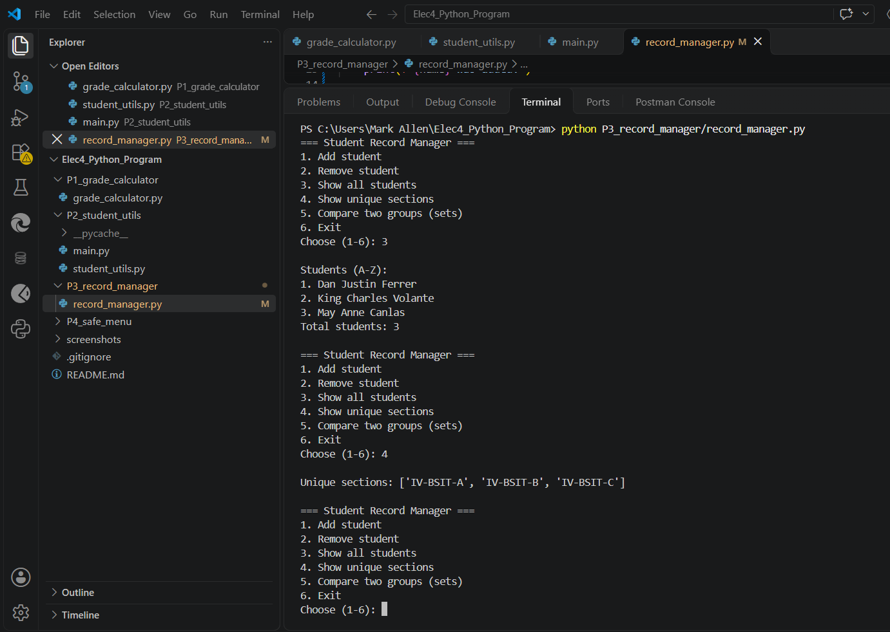
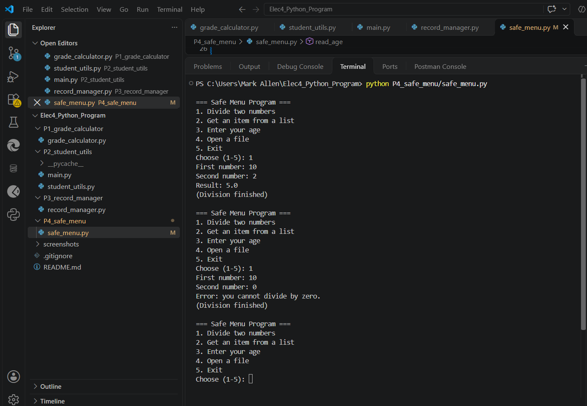
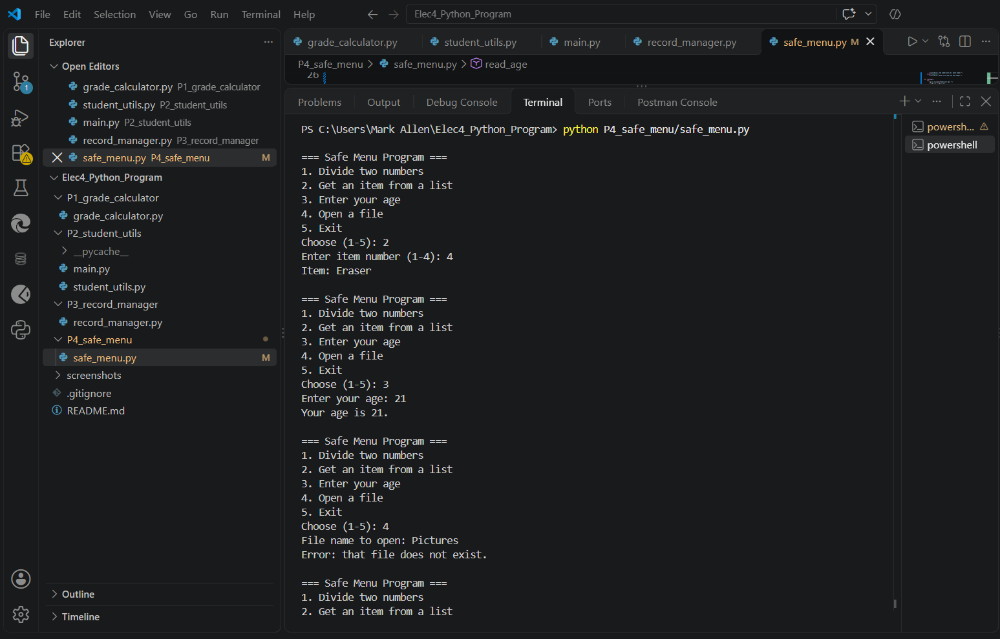

# Elec4_Python_Program (Set 1)

**Name:** Mark Allen Medrano
**Section:** IV-BSIT B

**Repository:** https://github.com/Aizz27/Elec4_Python_Program

## Activities

- **P1:** Student Grade Calculator (functions)
- **P2:** Custom module: student_utils
- **P3:** Student Record Manager (lists and sets)
- **P4:** Safe Menu Program (exceptions)

## Requirements

- Python 3 installed (check with `python --version`)
- Git installed (check with `git --version`)

## Get the code

**1. Clone the repository** (first time only):

    git clone https://github.com/Aizz27/Elec4_Python_Program.git
    cd Elec4_Python_Program

**2. Switch to the Set 1 branch:**

    git checkout set-1

If Git says the branch is not found, download the latest branches first and try again:

    git fetch origin
    git checkout set-1

**3. Already cloned before? Get the latest changes:**

    git checkout set-1
    git pull origin set-1

**4. Check that it worked:**

    git branch

The `*` should be next to `set-1`. You should also see the folders P1_grade_calculator, P2_student_utils, P3_record_manager, P4_safe_menu, and screenshots.

**Note:** After the Set 1 pull request is merged, all the code is also on the `main` branch:

    git checkout main
    git pull origin main

## How to run

Open a terminal in the main project folder (Elec4_Python_Program), then run the program you want.

**P1: Student Grade Calculator**

    python P1_grade_calculator/grade_calculator.py

Enter the student name, then the grade for each subject (Math, Science, English, Filipino). Each grade must be from 0 to 100.

**P2: Custom module student_utils**

Run it from inside the P2 folder, because main.py imports student_utils.py:

    cd P2_student_utils
    python main.py
    cd ..

Enter the first name, last name, and the grades separated by spaces (example: 75 80 85 90 95 100).

**P3: Student Record Manager**

    python P3_record_manager/record_manager.py

Choose an option from the menu (1 to 6). Choose 6 to exit.

**P4: Safe Menu Program**

    python P4_safe_menu/safe_menu.py

Choose an option from the menu (1 to 5). Choose 5 to exit.

## Screenshots

### P1: Student Grade Calculator

Testing the three functions:

Running the full program:

### P2: student_utils

### P3: Student Record Manager

Adding students:

Showing all students and the unique sections:

### P4: Safe Menu Program

Dividing two numbers, including the divide-by-zero error:

Getting an item, entering an age, and opening a file that does not exist:

